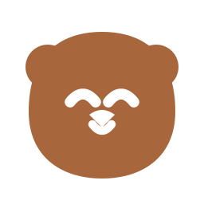

<p align="center">
  
</p>

<h1 align="center">Otter</h1>

<p align="center">
  <b>Lightning-fast, private file sharing across macOS, Windows, Linux, and Android — over your local Wi-Fi.</b>
</p>

<p align="center">
  <a href="#quick-installation"></a>
  <a href="#license"></a>
  <a href="https://swift.org"></a>
  <a href="https://www.rust-lang.org"></a>
  <a href="https://capacitorjs.com"></a>
</p>

---

## Overview

**Otter** is an open-source, lightweight file-sharing app that connects your **Mac**, **Windows PC**, **Linux**, and **Android** devices on the same local network. Files travel directly between devices over HTTPS. No cloud, no accounts, no internet required.

Otter is built on a shared **Rust core** (`core/otter-core`). The same engine powers the macOS menu bar app, the Windows desktop app, the Android app, and the command-line tool.

---

## Key Features

- **Shared Rust Core**: One transfer engine for every platform.
- **Native Apps**: macOS menu bar app (Swift), Windows desktop app (Electron), Android app (Capacitor + JNI), and a CLI for Windows and Linux.
- **Automatic Discovery**: Devices on your Wi-Fi find each other over multicast UDP, with a subnet scan fallback.
- **Encrypted Transfers**: HTTPS with a self-signed certificate per device. Each device has a stable fingerprint.
- **Integrity Checks**: Every file is verified with SHA-256 on arrival.
- **Browser Web Hub**: Any phone, tablet, or browser can send and receive files through `http://<device-ip>:7456`.
- **Terminal Ready**: One-line installers and a `--send` command for scripting.

> **Note**: Otter uses its own `/api/otter/v2/*` protocol. It is designed after the LocalSend v2 model but is **not** compatible with the LocalSend app. Otter devices talk to other Otter devices.

---

## Quick Installation

### macOS (Homebrew)

```bash
brew tap elmeeee/grasp-drop https://github.com/elmeeee/Grasp-drop.git
brew trust elmeeee/grasp-drop
brew install --cask otter
```

Or download `Otter.app` from the [Releases](https://github.com/elmeeee/Grasp-drop/releases) page.

---

### Windows (PowerShell)

```powershell
iwr -useb https://raw.githubusercontent.com/elmeeee/Grasp-drop/main/install.ps1 | iex
```

This downloads `otter-windows-x64.exe` as `otter.exe`, adds it to your User PATH, and lets you run `otter` in any terminal.

---

### Linux (Terminal)

```bash
curl -fsSL https://raw.githubusercontent.com/elmeeee/Grasp-drop/main/install.sh | sh
```

This installs the `otter` binary to `~/.local/bin/otter`.

---

## How to Use

### Mac

1. Make sure Wi-Fi is on and both devices are on the same network.
2. Open **Otter** from the menu bar.
3. Pick a device under **Nearby Devices** and choose the files to send.
4. Received files are saved to `~/Downloads/Otter`.

### Android, Windows, and Linux

1. Open Otter on the device. It becomes visible on the network automatically.
2. Select a nearby device and send files, or open the web hub on another device.

### Browser (phones, tablets, anything else)

1. Open `http://<device-ip>:7456` in a browser on the same network.
2. Upload files or download the ones that have been shared.

### Command line

```bash
otter                       # run the node and web hub
otter --no-web              # run the node only
otter --send 192.168.1.42 photo.jpg video.mp4
```

---

## Building from Source

### Prerequisites

- macOS 13+ with Xcode 15+ and Swift 5.9+ (macOS app)
- Rust stable with `cargo` (core)
- Node.js 18+ (Android and Windows apps)
- JDK 17 and the Android SDK/NDK (Android app)

### Build the Rust core

```bash
./scripts/build_core.sh
```

Cross-compiles the core for macOS, Windows, Linux, and every Android ABI. Outputs:

| Output | Target |
|---|---|
| `bin/otter` | macOS (host) |
| `bin/otter-windows-x64.exe` | Windows x64 |
| `bin/otter-linux-x64` | Linux x64 |
| `app/electron/resources/bin/otter.exe` | Windows app sidecar |
| `app/android/app/src/main/jniLibs/*/libotter_core.so` | Android ABIs |

### Build the macOS app

```bash
./build_mac_app.sh
open bin/Otter.app
```

### Build the Android app

```bash
./scripts/build_android.sh
# → bin/otter-android-debug.apk
```

### Build the Windows app

```bash
./scripts/build_windows.sh
# → app/electron/dist/Otter-<version>-x64.exe
```

---

## Architecture

```
core/otter-core/        Rust core: HTTPS server, discovery, sender, web hub, FFI, JNI
Sources/Otter/          macOS app (SwiftUI, AppKit) with the OtterShare layer
app/www/                Shared web UI for the Android and Windows apps
app/android/            Capacitor Android project (org.otter.app)
app/electron/           Electron Windows shell with the Rust sidecar
Resources/Otter/        Otter logo and menu bar icons
scripts/                Build scripts for core, Android, and Windows
```

### Wire protocol

| Endpoint | Purpose |
|---|---|
| `GET  /api/otter/v2/info` | Device info and fingerprint |
| `POST /api/otter/v2/register` | Two-way discovery handshake |
| `POST /api/otter/v2/prepare-upload` | Send file metadata, receive tokens |
| `POST /api/otter/v2/upload` | Send file bytes (verified by SHA-256) |
| `POST /api/otter/v2/cancel` | Cancel a session |
| `POST /api/otter/v2/prepare-download` | List files shared by a device |
| `GET  /api/otter/v2/download` | Download a shared file |

Discovery uses multicast UDP on `224.0.0.167:53317`. Transfers use HTTPS on port `53317`.

---

## Firewall

Allow incoming **TCP and UDP on port 53317**, and disable AP isolation on your router if devices cannot see each other.

---

## License

This project is licensed under the **MIT License**. See the [LICENSE](LICENSE) file for details.

---

<p align="center">
  Designed & built by <b>KaMy Studio</b>
</p>
